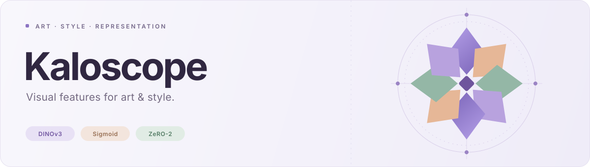

<picture>
  <source media="(prefers-color-scheme: dark)" srcset="assets/readme-dark.svg">
  
</picture>

<p align="center">
  <strong>为画师风格检索，训练适合自己作品库的图像特征。</strong><br>
  <sub>从画师与时间出发，学习作品之间的视觉联系。</sub>
</p>

<p align="center">
  <a href="TEMPORAL_TRAINING_ZH.md">使用文档</a>
  &nbsp; · &nbsp;
  <a href="configs/temporal.yaml">训练配置</a>
  &nbsp; · &nbsp;
  <a href="TEMPORAL_TRAINING_ZH.md#评估早停与检查点">特征提取</a>
  &nbsp; · &nbsp;
  <a href="LICENSE.md">License</a>
</p>

<br>

**Kaloscope** 利用画师身份与作品发布时间微调 DINOv3，学习同一画师相近时期作品的视觉联系。得到的图像向量可用于搭建画风检索与作品库浏览应用。

<table>
  <tr>
    <td width="33%" valign="top">
      <sub>01 / TRAIN</sub>
      <p><strong>训练你的特征</strong></p>
      <p>用画师与时间信息配对，让模型适应你的作品库。</p>
    </td>
    <td width="33%" valign="top">
      <sub>02 / EVALUATE</sub>
      <p><strong>验证检索效果</strong></p>
      <p>固定图库评估，同时关注跨角色、跨作品的检索表现。</p>
    </td>
    <td width="33%" valign="top">
      <sub>03 / EXPORT</sub>
      <p><strong>导出图像向量</strong></p>
      <p>保存最佳模型并提取特征，接入你的检索应用。</p>
    </td>
  </tr>
</table>

<br>

**三步开始训练**

1. **准备数据** — 按[数据说明](TEMPORAL_TRAINING_ZH.md#数据接口)准备图片清单、元数据和固定评估集。
2. **填写配置** — 在 [temporal.yaml](configs/temporal.yaml) 中设置数据路径、输出目录、模型路径和每卡 `batch_size`。
3. **启动训练** — Clone 后，在已有[依赖环境](requirements.txt)中从仓库根目录执行：

```bash
accelerate launch --config_file configs/accelerate_zero2.yaml --num_processes 8 \
  train_temporal.py --config configs/temporal.yaml
```

将 `--num_processes` 改为实际 GPU 数量，无需安装本项目。使用官方模型权重需先获得访问权限。

<br>

<details>
<summary><strong>训练之后：提取特征与断点续训</strong></summary>

结果保存在配置的 `output` 目录中：

| 输出 | 用途 |
| :--- | :--- |
| `best.pt` | 验证表现最佳的模型，用于提取图像特征 |
| `last.pt` + `state/` | 最近保存的模型与训练状态，用于续训 |
| 训练与验证日志 | 查看优化过程和检索指标 |

保留 `last.pt` 和 `state/`，在相同配置与 GPU 数量下，给启动命令加上 `--resume` 即可继续训练。
完整的特征提取代码见[使用说明](TEMPORAL_TRAINING_ZH.md#评估早停与检查点)。

</details>

<details>
<summary><strong>技术简览</strong></summary>

默认采用 **DINOv3 ViT-B/16 + 投影头**，通过 sigmoid 配对损失学习图像之间的关系。
Transformers 负责模型加载，Accelerate + DeepSpeed ZeRO-2 负责多卡训练。
时间窗口默认 365 天，可在配置中调整；训练过程包含自动学习率调整、早停和断点续训。
模型支持 Hugging Face ID 或本地 Transformers 模型目录。

配对规则、评估指标与全部配置见[使用文档](TEMPORAL_TRAINING_ZH.md)。

</details>

<br>

---

<p align="center">
  <sub>Kaloscope · Built with DINOv3</sub><br>
  <sub><a href="MODEL_CARD.md">DINOv3 模型说明</a> &nbsp; · &nbsp; <a href="LICENSE.md">DINOv3 License</a></sub>
</p>
